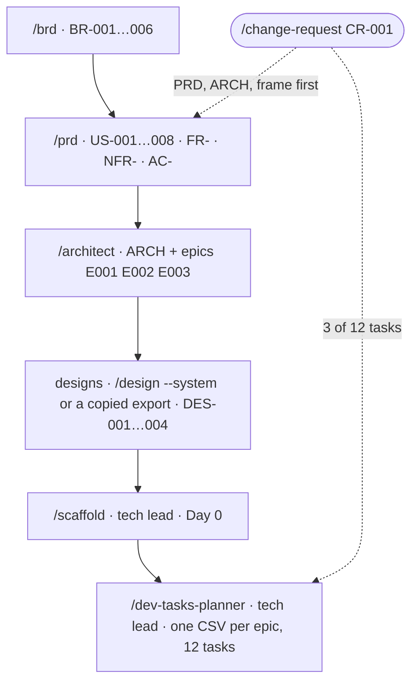

# CareSlot walkthrough — nexus v4, role by role

Every command below runs the same way: it **looks** at what exists, **asks** about gaps, shows a
**plan**, **stops** for your approval, **writes**, then **checks** its work against the project's
guide and opens a pull request with only `docs/` changes. The outputs shown are abbreviated.

The BRD and PRD cover the **whole product**. The architect then splits it into **epics** (one ADR file each);
the designs and the dev tasks (one CSV per epic) follow those epics.



## 1. Product owner — `/brd`

Input: notes from the kickoff workshop and last quarter's no-show report — `/brd notes.md report.md`. A problem
description works too (`/brd "Clinics lose 18% of slots to no-shows…"`), or nothing: then the interview does the work.

The command maps the notes onto the BRD template, then asks one round of questions for the gaps:

```
BRD — INTERVIEW
1. Goals: which matters most — fewer no-shows, fewer calls, or no double bookings?
2. Booking window: how far ahead can patients book?
3. Is there a limit on appointments per patient?
4. Until when can a patient cancel online?
```

Answers become business rules (`BR-001` 30 days ahead, `BR-002` at most 2 future appointments,
`BR-005` cancel until 2 hours before …). The open question about walk-in patients stays an
**Open Question** with an owner — nothing is invented. Result: [BRD.md](docs/requirements/BRD.md).

```
BRD — VALIDATE COMPLETE
Business rules: 6 (BR-001 … BR-006)   Goals/metrics: 4/4   Open questions: 1
Checks: R1 PASS · R7 PASS · R8 PASS
```

## 2. Product owner — `/prd`

The PRD turns each business rule into stories and requirements, and the plan shows coverage:

```
Coverage:  BR-001 → US-002, US-003, FR-BOOK-001, NFR-001, NFR-002
           BR-002 → US-003, FR-BOOK-002
           BR-003 → US-003, US-007, US-008, FR-BOOK-003, FR-SCHED-001, FR-SCHED-002
           BR-004 → US-006, FR-NOTIF-001, NFR-003
           BR-005 → US-004, US-005
           BR-006 → US-001, FR-AUTH-001, NFR-SEC-001, NFR-SEC-002      — none left unserved
```

Every story has testable acceptance criteria (`AC-006 A third future booking is refused with …`);
every NFR has a number. Result: [PRD.md](docs/requirements/PRD.md).

## 3. Architect — `/architect careslot`

The architect's guide asks for 9 sections, decisions on `**Choice**` lines and an ADR per major
decision. The plan's coverage map ties every PRD ID to a section; for example `FR-BOOK-003`
(no double bookings) → §5 Data Model's unique constraint → `ADR-CARESLOT-E001-002`.

It also splits the product into **epics** — one ADR file each, with `Epic:` and `Covers:` lines; every story
and functional requirement lands in exactly one.

`ingest_architecture_doc` on the result:

```
status: ok   sections: 9/9   stack (from Choice lines): Django, Python, htmx, Tailwind CSS,
PostgreSQL, Celery, Redis, Docker, AWS   ADRs: 3
epics: E001 Booking        US-002 US-003 US-004 US-005 FR-BOOK-001…004
       E002 Schedule       US-001 US-007 US-008 FR-AUTH-001 FR-SCHED-001 FR-SCHED-002
       E003 Notifications  US-006 FR-NOTIF-001
```

React appears in the doc only in a note ("the designer's export … is a behaviour reference"), so it
is **not** part of the stack. Result: [docs/arch-docs/careslot/](docs/arch-docs/careslot/).

## 4. Designer — `/design careslot --system docs/designs/design-system` (optional)

The designer's own design system is in [docs/designs/design-system/](docs/designs/design-system/) (tokens,
components, rules). `/design careslot --system …` builds one HTML frame per story, epic by epic, from that system
only, plus `tokens.css` and `design.json`. Working in Claude Design (Claude Desktop) or Figma Make instead? Copy the
exported files into `docs/designs/careslot/` and commit — no command needed; `/scaffold` reads them directly.
This example also carries a React version of the screens (from habit). `ingest_design_export` reads it all by content:

```
DES-001  Book Appointment  → BookAppointmentScreen.jsx  states: empty, loading, error, disabled
DES-002  Clinic Schedule   → ClinicSchedulePage.jsx     states: empty, loading, error, disabled
DES-003  My Appointments   → MyAppointmentsPage.jsx     states: empty, loading, error, disabled
DES-004  Sign In           → SignInScreen.jsx           states: loading, error, disabled
Coverage: US-001 … US-008 all on a screen    Colours not in the tokens: none    Findings: none
```

A first export usually isn't this clean — typical findings are a colour that isn't a token or a
screen with no empty state, each explained with the fix. Result: [docs/designs/careslot/](docs/designs/careslot/)
and its `design.json` (written by `/design`; a copied export has none, and that's fine).

## 5. Tech lead — `/scaffold` (Day 0, once)

Before anyone plans tasks, the tech lead runs `/scaffold` once on the approved docs (`/dev-tasks-planner`
refuses to start without scaffolded code). It reads the architecture's stack (Django 5, htmx, PostgreSQL,
Celery — from the Choice lines), the epics, and the designs (`design.json`, or the copied frames and tokens), then:

- resolves exact package versions with `resolve_package_versions` (pip/uv for Django, npm for Tailwind);
- creates the project skeleton: the `accounts`, `scheduling`, `booking`, `frontdesk` and `notifications`
  apps from the architecture's Component Breakdown, settings, Docker, CI, linters and hooks;
- turns `tokens.css` into the Tailwind theme and builds one template shell per screen (DES-001 … DES-004)
  from the HTML frames — not from the React export, because the stack isn't React;
- writes `AGENTS.md` and `knowledge/`, and passes its build gate (`python manage.py check`).

The result is the code at this example's root: `careslot/` (settings, Celery), the apps, `templates/` with one shell
per screen (each names its DES id), `static/src/app.css`, Docker, CI, `AGENTS.md`, `knowledge/`. Versions are pinned
exactly (Django 5.2.19, Celery 5.7.0, Tailwind 4.3.5 …); `manage.py check` passes. No business logic yet — that's
what the tasks are for, which is why the tech lead plans them **against this code** next: each task names the
files it changes or creates (e.g. BOOK-004 → a new migration on `booking/models.py`'s `Appointment`).

## 6. Tech lead — `/dev-tasks-planner careslot`; developers — `/evaluate`, `/plan`, `/apply`, `/validate`

Tasks are planned from the architecture and the screens, one CSV per epic (`booking-tasks.csv` for E001,
`schedule-tasks.csv` for E002, `notifications-tasks.csv` for E003); each cites the IDs it implements, and
`trace_tasks` fills the `TRACE_IDS` column from that text:

```
BOOK-004  Double-booking constraint   TRACE_IDS: US-003, FR-BOOK-003, ADR-CARESLOT-E001-002, AC-007
NOTIF-002 SMS reminder                TRACE_IDS: US-006, FR-NOTIF-001, AC-011, NFR-003
```

Developers then run `/evaluate BOOK-004`, `/plan`, `/apply`, `/validate` — four separate commands, as in nexus 3;
`load_task` returns the task with its trace IDs, and `/evaluate` reads the requirements and screen
those IDs point to. Result:
[docs/dev-tasks/careslot/](docs/dev-tasks/careslot/).

## 7. Change request — `/change-request CR-001 "…"`

A month in, the clinic manager asks for two changes: the reminder should come **2 hours** before (not
24), and patients must give a **reason** when they cancel.

1. **Product owner** updates the PRD: `FR-NOTIF-001` 24 h → 2 h (same ID), new `FR-BOOK-004`, new `AC-015`
   under `US-005`.
2. **Architect** updates the doc, the Booking epic's `Covers:` line (FR-BOOK-004) and `ADR-CARESLOT-E003-001`
   (`cancel_reason` column; reminder timing).
3. **Designer** adds the reason picker to *My Appointments* and commits the new frame (or re-runs `/design`) — the
   screen keeps `DES-003`.
4. `record_change_request` reads the git diff of `docs/` and writes [CR-001.json](docs/change-requests/CR-001.json):

```
CR-001  Changed: FR-NOTIF-001, US-005    Added: AC-015, FR-BOOK-004    Removed: —
Affected dev tasks: BOOK-005 (US-005), NOTIF-002 (FR-NOTIF-001)      ← BOOK-006 doesn't exist yet
```

Lines that only *mention* an ID don't count: the new `FR-BOOK-004` row says "serves BR-005", but BR-005
didn't change, so tasks tracing to BR-005 are untouched.

5. **Tech lead** runs `/dev-tasks-planner cr CR-001`: it re-plans **only** `BOOK-005` and `NOTIF-002`
   (`NOTIF-002` now says 2 hours) and adds `BOOK-006` for `FR-BOOK-004`. The other 9 tasks are not touched.

## Exercise — rehearse CR-002

In your copy (see the README), make this change and follow it through:

> **CR-002** — the clinic allows **3** future appointments per patient instead of 2.

1. Product owner (`--role product`): `/change-request CR-002 "Allow 3 future appointments"` — update `BR-002`
   in the BRD and `FR-BOOK-002` / `AC-006` in the PRD (same IDs).
2. Check the record: it should list `AC-006`, `BR-002`, `FR-BOOK-002` and `US-003` (the story `AC-006` sits
   under) as changed, and nothing added or removed.
3. Tech lead: `/dev-tasks-planner cr CR-002` — which rows should it re-plan? (Answer: `BOOK-003` and
   `BOOK-004`, which trace to `US-003` / `FR-BOOK-002` / `AC-006`, and the `EPIC-BOOKING` row, whose summary
   cites `BR-002`; the other 12 rows stay as they are.)
