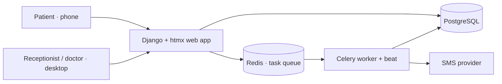

# Architecture Document — CareSlot

<!-- Example project for nexus v4. CareSlot and everything in it is made up. -->

## 1. Document Metadata

| Field | Value |
|---|---|
| Version | 1.0 (updated for CR-001 on 2026-11-30) |
| Status | Accepted |
| Owner | Solution architect, CareSlot |
| Sources | BRD.md v1.0, PRD.md v1.1 |
| Epics (one ADR file each) | E001 Booking — ADR-CARESLOT-E001-Booking-v1.0.md · E002 Schedule — ADR-CARESLOT-E002-Schedule-v1.0.md · E003 Notifications — ADR-CARESLOT-E003-Notifications-v1.0.md |

## 2. System Overview

One server-rendered web application for patients, receptionists and doctors, backed by a single
PostgreSQL database and a background worker for reminders. Patients use it on their phones
(US-002 – US-006); staff use it on desktops (US-007, US-008). Two developers maintain it, so the
design favours one deployable unit over services (BRD §9).

## 3. Component Breakdown

| Component | Responsibility | Covers |
|---|---|---|
| `accounts` | Sign-in, lockout, sessions, roles (patient / receptionist / doctor) | US-001, FR-AUTH-001, NFR-SEC-002 |
| `scheduling` | Doctors' weekly hours, free-slot calculation | US-002, FR-BOOK-001, NFR-001 |
| `booking` | Book, cancel (with reason), the 2-appointment limit, double-booking protection | US-003, US-004, US-005, FR-BOOK-002, FR-BOOK-003, FR-BOOK-004 |
| `frontdesk` | Daily schedule for receptionists, doctor's day view | US-007, US-008, FR-SCHED-001, FR-SCHED-002 |
| `notifications` | Reminder scheduling and SMS sending | US-006, FR-NOTIF-001, NFR-003 |

## 4. Technology Choices

### Web framework
- **Choice**: Django 5 (Python 3.12), server-rendered templates
- **Rationale**: one deployable unit for a two-developer team (BRD §9); built-in auth, admin and migrations cover FR-AUTH-001 and the staff tooling.
- **ADR**: ADR-CARESLOT-E001-001

### Interactivity
- **Choice**: htmx for partial page updates (slot picker, schedule grid)
- **Rationale**: the designs need live updates in a few places (US-002, US-007), not a single-page app.
- **Note**: the designer's export includes a React version of the screens; it is a behaviour reference only. Screens are built from the HTML frames and tokens.

### Styling
- **Choice**: Tailwind CSS, with the design tokens as CSS variables

### Database
- **Choice**: PostgreSQL 16
- **Rationale**: a unique constraint on (doctor, slot start) makes double bookings impossible (BR-003, FR-BOOK-003).
- **ADR**: ADR-CARESLOT-E001-002

### Background jobs
- **Choice**: Celery with Redis as the broker, Celery beat for scheduled reminders
- **Rationale**: reminders must go out within 5 minutes of their time (NFR-003) independent of web traffic.
- **ADR**: ADR-CARESLOT-E003-001
- **Prior choice (superseded)**: cron + a management command — dropped because it can't retry a failed SMS.

### Hosting
- **Choice**: Docker containers on AWS in the clinic's region (NFR-SEC-001, BR-006)

## 5. Data Model

| Table | Key columns | Notes |
|---|---|---|
| `doctor` | id, name, clinic | |
| `working_hours` | doctor_id, weekday, start, end | FR-BOOK-001 |
| `appointment` | id, doctor_id, patient_id, starts_at, status, cancel_reason | **unique (doctor_id, starts_at) where status = booked** — FR-BOOK-003; cancel_reason required when status = cancelled — FR-BOOK-004 |
| `reminder` | appointment_id, send_at, sent_at, attempts | FR-NOTIF-001, NFR-003 |
| `access_log` | user_id, patient_id, action, at | NFR-SEC-001 |

## 6. Integration and API Design

- Server-rendered pages; htmx endpoints return HTML fragments (`/slots?doctor=…&day=…`, `/schedule/<day>`).
- SMS provider over HTTPS with retries (3 attempts, exponential backoff); provider chosen per BRD §8 dependency.
- No public API in release 1.

## 7. Deployment Topology

- `web` (Django + gunicorn) ×2, `worker` (Celery) ×1, `beat` ×1, managed PostgreSQL and Redis — all in the clinic's region.
- One pipeline: tests → image build → deploy; migrations run before the new web containers start.

## 8. NFR Fulfillment

| NFR | How it is met |
|---|---|
| NFR-001 | Free slots computed with one indexed query per doctor-day; fragments cached for 30 s. |
| NFR-002 | Two web containers behind a load balancer; health checks restart a failed container. |
| NFR-003 | Celery beat schedules reminders every minute; a failed send retries 3 times. |
| NFR-SEC-001 | Single-region hosting; every read of patient data writes to `access_log`. |
| NFR-SEC-002 | Django session expiry set to 30 minutes of inactivity. |

## 9. Open Questions and Deferred Decisions

| # | Question | Owner |
|---|---|---|
| 1 | Holiday blocking for doctors (PRD open question 1) — model as `time_off` table if needed. | Solution architect |
