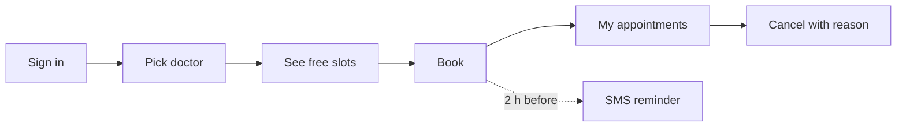

# PRD — CareSlot · appointments

<!-- Example project for nexus v4. CareSlot and everything in it is made up.
     v1.1 includes change request CR-001 (see docs/change-requests/CR-001.json). -->

| Field | Value |
|---|---|
| Version | 1.1 |
| Date | 2026-11-30 |
| Owner | Product owner, CareSlot clinics |
| BRD | BRD.md v1.0 |
| Status | Approved |

## 1. Overview

Release 1 lets patients book, see and cancel their appointments online, gives the front desk one
reliable daily schedule, and reminds patients before each visit — serving the goals of fewer
no-shows, fewer booking calls and no double bookings (BRD §3).

## 2. Personas

| Persona | Who | Goal | Device |
|---|---|---|---|
| Patient | Adult booking for themselves | Book a visit without calling | Mobile first, desktop too |
| Receptionist | Front-desk staff | Keep every doctor's day correct and full | Desktop |
| Doctor | Clinic doctor | Know the day's appointments | Desktop |

## 3. User Stories

### US-001 — Sign in
As a patient or staff member, I want to sign in with my email and password, so that only I see my
appointments. *(serves BR-006)*
- AC-001 A wrong email or password shows "Invalid email or password" and nothing else.
- AC-002 After 5 failed attempts the account is locked for 15 minutes.

### US-002 — See free slots
As a patient, I want to see a doctor's free slots for the next 30 days, so that I can pick a time
that suits me. *(serves BR-001)*
- AC-003 Only free slots are shown, in 20-minute steps within the doctor's working hours.
- AC-004 Days without free slots say "No free slots on this day".

### US-003 — Book an appointment
As a patient, I want to book a free slot, so that I don't have to call. *(serves BR-001, BR-002, BR-003)*
- AC-005 A booked slot is gone for everyone else immediately.
- AC-006 A third future booking is refused with "You already have 2 upcoming appointments".
- AC-007 If two patients book the same slot at once, exactly one booking succeeds; the other sees "This slot was just taken".

### US-004 — See my appointments
As a patient, I want to see my upcoming appointments, so that I know when to come. *(serves BR-005)*
- AC-008 With no upcoming appointments the page says "Nothing here yet".

### US-005 — Cancel an appointment
As a patient, I want to cancel an appointment online, so that the slot goes to someone else.
*(serves BR-005)*
- AC-009 Cancelling is possible until 2 hours before the start; after that the button is disabled and says "Call the front desk to cancel".
- AC-010 A cancelled slot is free again for other patients immediately.
- AC-015 A cancellation reason must be chosen before cancelling ("Reason is required"). *(added by CR-001)*

### US-006 — Get a reminder
As a patient, I want a reminder before my appointment, so that I don't forget it. *(serves BR-004)*
- AC-011 The reminder names the doctor, date, time and clinic, and a link to cancel.

### US-007 — Manage the daily schedule
As a receptionist, I want to see and change every doctor's appointments for a day, so that the
schedule stays correct. *(serves BR-003)*
- AC-012 A day with no appointments shows "No appointments for this day".
- AC-013 The receptionist can book, move or cancel any appointment, with the same double-booking protection as patients.

### US-008 — See my day
As a doctor, I want to see my appointments for today, so that I can plan my day. *(serves BR-003)*
- AC-014 The list shows time, patient name and visit reason, in time order.

## 4. Functional Requirements

| ID | Requirement | Serves | Stories |
|---|---|---|---|
| FR-AUTH-001 | Email + password sign-in with lockout after 5 failed attempts for 15 minutes. | BR-006 | US-001 |
| FR-BOOK-001 | Free slots are computed from each doctor's weekly working hours, 20-minute slots, 30 days ahead. | BR-001 | US-002 |
| FR-BOOK-002 | Booking refuses a patient's third future appointment. | BR-002 | US-003 |
| FR-BOOK-003 | The database guarantees one booking per doctor and slot start, so concurrent bookings can't both succeed. | BR-003 | US-003, US-007 |
| FR-BOOK-004 | A cancellation reason (from a fixed list) is required to cancel; reasons are reported monthly. *(added by CR-001)* | BR-005 | US-005 |
| FR-SCHED-001 | Receptionists can book, move and cancel appointments for any doctor and day. | BR-003 | US-007 |
| FR-SCHED-002 | Doctors see their own appointments for the day, read-only. | BR-003 | US-008 |
| FR-NOTIF-001 | An SMS reminder is sent 2 hours before each appointment. *(changed by CR-001: was 24 hours)* | BR-004 | US-006 |

## 5. Non-Functional Requirements

| ID | Requirement (measurable) | Serves |
|---|---|---|
| NFR-001 | The free-slots page loads in ≤ 2 s at the 95th percentile with 200 concurrent users. | BR-001 |
| NFR-002 | Booking is available 99.5 % of each month. | BR-001 |
| NFR-003 | Reminders go out within 5 minutes of their scheduled time. | BR-004 |
| NFR-SEC-001 | Patient data is stored and processed in the clinic's region; access is logged. | BR-006 |
| NFR-SEC-002 | Sessions expire after 30 minutes without activity. | BR-006 |

## 6. Flows

## 7. Release Scope

**In this release:** US-001 – US-008, FR-AUTH-001, FR-BOOK-001 – FR-BOOK-004, FR-SCHED-001, FR-SCHED-002, FR-NOTIF-001, all NFRs.

**Out of this release:** payments, video consultations, medical-records integration (BRD §5).

## 8. Dependencies

- An SMS provider account for the clinic's region.
- Doctors' weekly working hours, provided by the clinic manager before launch.

## 9. Open Questions

| # | Question | Owner | Due |
|---|---|---|---|
| 1 | Do doctors need to block single days (holidays) in release 1, or is the weekly schedule enough? | Clinic manager | Before sprint 2 |
| 2 | Since CR-001 the reminder arrives 2 hours before the visit — exactly when online cancelling closes (BR-005), so the SMS can't offer a working cancel link. Move the cut-off, send the reminder earlier, or make the SMS link call the front desk? *(raised by CR-001)* | Clinic manager | Before the reminder task ships |
